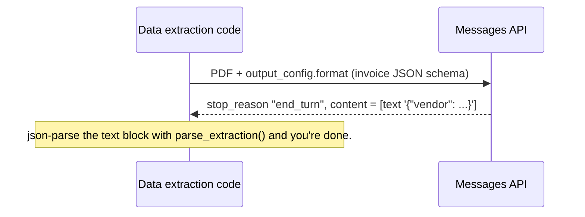

# Invoice Extraction with the Claude Message Batches API

A small Python learning project that extracts fields from fake PDF invoices with Claude, first one request at a time and then through the Message Batches API.

This is a self-directed experiment. It uses 23 generated invoices, some clean and some deliberately broken, to show what the Batches API does with tool calls, timing, cost, retries, and failures.

Status: stages 1–8 are built (test data, JSON schema, synchronous dry run, batch submit, status, results, triage, one retry round). Batch stages are added one at a time.

## Setup

You need uv, Python 3.12 or newer, and an Anthropic API key.

From the project directory, install the dependencies:

```bash
uv sync
```

Create your local environment file:

```bash
cp .env.example .env
```

Edit `.env` and replace the placeholder with your key:

```dotenv
ANTHROPIC_API_KEY=your-anthropic-api-key-here
```

Scripts that call the API exit with a message if the key is missing, and never print it.

Models are constants in `src/invoice_batch/config.py` and can be overridden in `.env`:

| Variable | Default | Used for |
| --- | --- | --- |
| `MODEL` | `claude-haiku-5-5` | attempts 1 and 2 |
| `ESCALATION_MODEL` | `claude-sonnet-5-5` | the last attempt for documents that keep failing |

## Run

Each stage is a command registered in `pyproject.toml` under `[project.scripts]`:

| Stage | Command | Calls the API? |
| --- | --- | --- |
| 1 | `uv run generate-invoices` | No. Writes `data/invoices/*.pdf` and `data/ground_truth.json` |
| 2 | `uv run show-schema` | No. Prints the invoice JSON schema |
| 3 | `uv run dry-run` | Yes, 4 synchronous requests (well under $0.01) |
| 4 | `uv run submit-batch` | Only with `--yes`. Without it, prints the plan and a cost estimate |
| 5 | `uv run check-batch [--watch]` | Yes, but free (status only). Updates `batch.json` |
| 6 | `uv run collect-results` | Yes, but free (downloads results). Writes `results.jsonl` |
| 7 | `uv run triage` | No. Writes `triage.json` and prints predicted vs. actual |
| 8 | `uv run retry-batch` | Only with `--yes`. Submits the retryable documents as the next round, in a new run folder |

`check-batch`, `collect-results`, `triage` and `retry-batch` use the newest run by default. You can also pass a run folder (`runs/20261116-011243` or just `20261116-011243`) or a batch id.

## Test

```bash
uv run pytest
uv run ruff format .     # format
uv run ruff check .      # lint
```

The tests never call the API. They cover the invoice JSON schema (generated from the Pydantic model, checked against the structured-output rules), the request builder, batch building and submitting (with a fake client), pricing, the API key check, and the generated test set (counts, totals, reproducibility). New behavior is added test-first: write a failing test, then the code that makes it pass.

## How it works

### The test documents

`generate-invoices` uses a fixed random seed and reportlab's invariant mode, so it produces byte-identical files every time. `data/` is git-ignored; re-run the command to recreate it.

| custom_id | Group | Expected outcome |
| --- | --- | --- |
| `01`–`16` `_clean_<layout>` | Clean invoices in 3 layouts (classic, modern, compact). `06` has no due date, so null is correct | `VALID` |
| `17_cluttered` | Small digits on a background of decoy digits | `RETRY_ESCALATE` |
| `18_footer_due_date` | Due date only in a 5pt grey footer | `RETRY_WITH_HINT` |
| `19_unusual_format` | Dates like `11.II.2026`, money like `Fr. 1'209.67` | `RETRY_WITH_HINT` |
| `20_total_mismatch` | Printed total is 100.00 more than the line items | `STABLE_ANSWER` |
| `21_corrupt` | Random bytes named `.pdf` | `NO_RETRY` |
| `22_letter` | A change-of-address letter | `NO_RETRY` |
| `23_blank` | A blank page | `NO_RETRY` |

`ground_truth.json` stores the true field values and the expected outcome for each document, so predictions can be compared with what actually happens.

Claude receives each PDF page as an image **and** as its extracted text. Small grey print is therefore still easy to read through the text layer. That is why `17_cluttered` puts its decoy digits into the text layer as well, not just into the picture.

### Program flow



`INVOICE_SCHEMA` (`schema.py`, generated from the `InvoiceExtraction` Pydantic model) describes the reply: nullable fields, `is_invoice`, and an `issues` list. Sending it as `output_config.format` makes the API guarantee that Claude's reply is JSON matching the schema (keys, types, no extras). Nullable fields (`str | None`, sent as `anyOf: [string, null]`) let Claude report "not printed" instead of inventing a value. Every model gets the same request, so the Haiku attempts and the Sonnet escalation look identical.

### Structured outputs: JSON outputs vs. strict tools

The API has two structured-output features. This project uses the first; stage 10 uses the second.

| Feature | Set on | Guarantees | Use when |
| --- | --- | --- | --- |
| JSON outputs | `output_config.format` | Claude's **reply** is JSON matching the schema | You just want the answer as data (this project's extraction) |
| Strict tool use | `strict: true` on a tool | A **tool call's arguments** match the tool's schema | Claude calls a tool that your code runs (stage 10's `lookup_crm`) |

Neither forces the other: JSON outputs never produce a tool call, and `strict` doesn't make Claude call a tool, it only guarantees the arguments when it does.

### One request

```
system  (cache_control, 1h)       identical for every document, so it can be cached
thinking  adaptive, summarized   the model decides whether to think; we can read a summary
output_config.format              the invoice JSON schema (same for every document)
messages[0] user:
    document  (base64 PDF)
    text      "Extract the data from this document."
              (+ a hint on retries)
```

### Retry rounds

`retry-batch` reads the newest `triage.json` and submits only the documents in a `RETRY_*` class, as a new batch in a new run folder. The new `batch.json` records `round` and `parent_run`, so `triage` in that folder can follow the link back and see the earlier attempts.

```
runs/20261116-040415/   round 1   23 docs   triage: 20_total_mismatch RETRY_WITH_HINT
        ▲ parent_run
runs/<new stamp>/       round 2    1 doc    triage (with round-1 history): same values -> STABLE_ANSWER
```

| Class | Next round's model | Hint |
| --- | --- | --- |
| `RETRY_WITH_HINT` | `MODEL` | the failed checks from `triage.json` |
| `RETRY_SAME` | same as last time | same as last time (the request is unchanged) |
| `RETRY_ESCALATE` | `ESCALATION_MODEL` | the failed checks from `triage.json` |

A run that already has a retry round can't be retried again, so the same round isn't paid for twice.

## Code organization

The code is a package in `src/invoice_batch/`. Library modules hold the logic and are covered by tests; `cli/` holds thin commands that call them and print results.

```
src/invoice_batch/
├── config.py            paths, MODEL / ESCALATION_MODEL, API key check, client
├── schema.py            InvoiceExtraction (single source), INVOICE_SCHEMA, OUTPUT_FORMAT, parse_extraction()
├── request_builder.py   system prompt, build_params()
├── batch.py             build_requests(), check_limits(), submit(), estimate_batch_cost()
├── pricing.py           PRICES, cost_usd() (standard vs. batch)
├── runs.py              run folders: resolve_batch(), batch.json, atomic file writes
├── status.py            describe(), watch(), update_batch_record()
├── results.py           record_from_result(), collect(), results.jsonl
├── triage.py            the failure policy: check_extraction(), triage_one(), triage_run()
├── retry.py             plan_retries(), load_histories() (follows parent_run links)
├── compare.py           learning only: truth_diffs(), expected/prediction verdicts
├── synthetic/           the fake test set
│   ├── data.py          vendors, customers, make_invoice(), truth_of()
│   ├── layouts.py       classic, modern, compact, cluttered, letter pages
│   └── build.py         generate(): all 23 documents + ground_truth.json
└── cli/                 one module per command
    ├── generate_invoices.py
    ├── show_schema.py
    ├── dry_run.py
    ├── submit_batch.py
    ├── check_batch.py
    ├── collect_results.py
    ├── triage.py
    └── retry_batch.py
tests/                   pytest, one file per library module
```

- `schema.py`: the `InvoiceExtraction` Pydantic model is the only definition of the fields; the SDK's `transform_schema()` generates `INVOICE_SCHEMA` from it. `OUTPUT_FORMAT` is sent to the API; `parse_extraction()` reads the reply's text block into an `InvoiceExtraction`.
- `request_builder.py`: `build_params()` returns the full request for one PDF. The dry run and the batch stages use the same function.
- `synthetic/build.py`: `generate(out_dir, seed=42)` writes the PDFs and ground truth. It takes the output folder as an argument, so tests can write to a temporary folder.
- `cli/dry_run.py`: sends 4 documents synchronously and prints the raw JSON text block, the parsed result, `stop_reason`, usage, and any error.
- `batch.py` / `cli/submit_batch.py`: builds one request per PDF, checks the batch limits, prints a cost estimate, and only submits with `--yes`. Saves `runs/<timestamp>/batch.json`.

## Project files

| File | Purpose |
| --- | --- |
| `src/invoice_batch/` | The package (see above) |
| `tests/` | pytest suite; runs offline |
| `pyproject.toml` | Dependencies, the stage commands, pytest settings |
| `.env.example` | Environment configuration template |
| `data/` | Generated test set (git-ignored) |
| `runs/` | Batch run outputs, added in later stages (git-ignored) |

After editing dependencies in `pyproject.toml`, run `uv sync`. You can also use `uv add package-name` or `uv remove package-name`.
