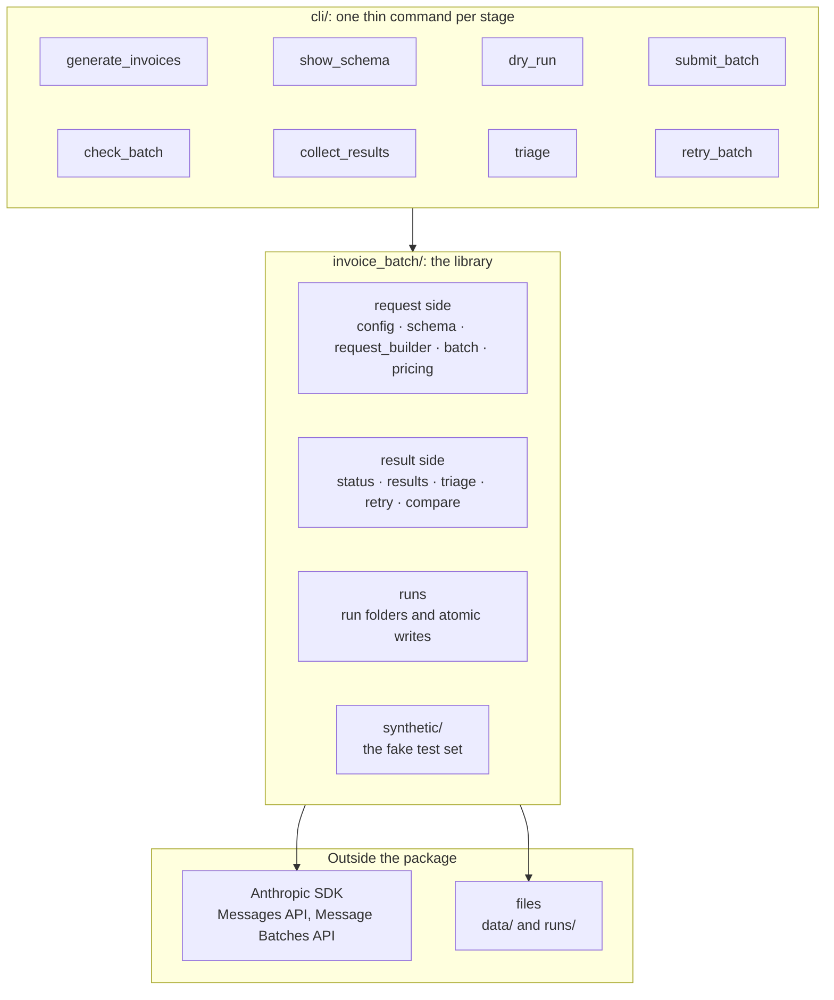
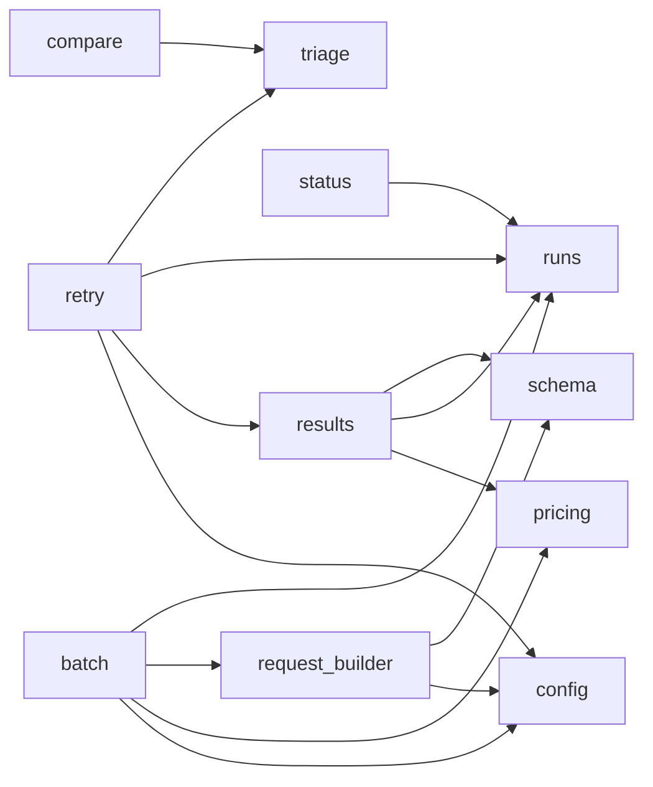

# Architecture

This document describes how the project is put together as of stage 8. The README explains what each stage does and shows the stage and retry diagrams. This file explains where the code for that lives, which files pass data between stages, and the rules the code follows.

## The layers

The project has three layers. Commands are thin. The library holds all the logic and is fully tested. Only the library talks to the Anthropic SDK and the file system.



A command reads its arguments, calls library functions, and prints. Some commands still hold a little logic of their own. See "Known gaps" at the end.

## Modules

| Module | Responsibility | Uses |
| --- | --- | --- |
| `config.py` | Paths, `MODEL` and `ESCALATION_MODEL` (overridable by environment variables), the API key check, and the client | nothing |
| `schema.py` | The `InvoiceExtraction` Pydantic model, which is the only definition of the fields. `INVOICE_SCHEMA` is generated from it, and `parse_extraction()` reads a reply | nothing |
| `request_builder.py` | The system prompt, and `build_params()`, which builds the full request for one PDF. The dry run and every batch use it | config, schema |
| `pricing.py` | Token prices and `cost_usd()`, at standard or batch price | nothing |
| `batch.py` | Builds one batch request per document, checks the batch limits, submits, writes `batch.json`, and estimates cost, including the 3-round worst case | config, pricing, request_builder, runs |
| `runs.py` | Run folders: finds a run from a folder, a folder name or a batch id, reads `batch.json`, and writes files atomically | nothing |
| `status.py` | Asks the API for a batch's status, polls with `watch()`, and keeps `batch.json` current | runs |
| `results.py` | Turns raw batch results into one flat record per document, and reads and writes `results.jsonl` | pricing, runs, schema |
| `triage.py` | The failure policy: `check_extraction()`, `triage_one()` and `triage_run()`. Pure functions, no files | nothing |
| `retry.py` | Plans the next round (model and hint per document), and follows `parent_run` links to load each document's earlier attempts | config, results, runs, triage |
| `compare.py` | For learning only: compares triage with ground truth and with your predictions | triage |
| `synthetic/data.py` | Vendors, customers, line items, `make_invoice()` and `truth_of()` | nothing |
| `synthetic/layouts.py` | The reportlab page layouts (classic, modern, compact, cluttered, letter) | synthetic.data |
| `synthetic/scan.py` | Image-only scanned pages: draws with Pillow, degrades the image, and saves a PDF with no text layer | nothing |
| `synthetic/build.py` | `generate()` builds all 26 documents and `ground_truth.json` | synthetic.data, synthetic.layouts, synthetic.scan |

How the library modules depend on each other. An arrow means "imports".



`triage.py` imports nothing from the project. It is the core of the policy, and keeping it free of files and API calls makes it easy to test and to reuse in stage 9.

## Data and files

Stages pass data to each other only through files. That is why each stage can be run, rerun or inspected on its own.

```text
data/                                   written by generate-invoices
├── invoices/<custom_id>.pdf            the 26 test documents
└── ground_truth.json                   true values + expected outcome per document

runs/<YYYYMMDD-HHMMSS>/                 one folder per batch, i.e. one round
├── batch.json                          written by submit-batch or retry-batch, updated by check-batch
├── results.jsonl                       written by collect-results
├── predictions.json                    written by you (optional): succeed / retry / review
└── triage.json                         written by triage
```

| File | What it holds | Read by |
| --- | --- | --- |
| `batch.json` | `batch_id`, times, `custom_ids`, the model per document, status and counts. Retry rounds add `round`, `parent_run`, `parent_batch_id` and `hints`. Never the PDF bytes | check-batch, collect-results, triage, retry-batch |
| `results.jsonl` | One record per document: `result_type`, model, `stop_reason`, usage, `cost_usd`, thinking summary, `extraction`, `parse_ok` / `parse_problem`, `error_type` / `error_message` | triage, retry-batch (as history) |
| `triage.json` | `batch_id`, `round`, counts, and per document its `class`, `reason`, `problems` and `attempt` | retry-batch |
| `ground_truth.json` | The true values and the expected outcome for each document | triage (comparison table only) |

How the run folders of one experiment link together:

```text
runs/A/  round 1  batch.json { round: 1 }
   ▲
   │ parent_run
runs/B/  round 2  batch.json { round: 2, parent_run: "A", hints: {...} }
   ▲
   │ parent_run
runs/C/  round 3  batch.json { round: 3, parent_run: "B", hints: {...} }
```

`retry.load_histories()` follows these links back to round 1, so triage knows each document's earlier attempts. The attempt number is the number of earlier records plus one.

## One request

Every request has the same shape, whatever the model, the round or the document. Only the PDF, the model and the optional hint change.

```text
model                    MODEL, or ESCALATION_MODEL on the last attempt
system (cache_control)   the shared instructions, cached for 1 hour
thinking                 adaptive, with summaries
output_config.format     INVOICE_SCHEMA, so the reply is JSON that matches it
messages[0] (user)       document block (base64 PDF), then the instruction text (+ hint)
```

## Design rules

These rules hold throughout the code. The reasons are recorded in the Decisions section of the spec.

- **One source for the schema.** The Pydantic model is the only definition of the fields. The API schema is generated from it with the SDK's `transform_schema()`, so the two can never drift apart.
- **The policy never reads ground truth.** `triage.py` checks only the reply itself: whether it is complete, whether its dates are valid, and whether its line items add up. A real pipeline has no answer key. Ground truth is used only by `compare.py`, for learning.
- **Nullable instead of invented.** Every field that might not be readable is nullable, including line-item quantity and unit price. Claude can then say "unreadable" instead of guessing, and triage turns a null into a precise hint.
- **Spending money needs `--yes`.** `submit-batch` and `retry-batch` print the plan and the cost estimate, then stop, unless `--yes` is given.
- **A round is never paid for twice.** `retry-batch` refuses a run that already has a retry run (`find_retry_runs()`).
- **Run files are written atomically.** Every write goes to a temporary file that is then renamed into place, so a crash never leaves a half-written file.
- **Results are matched by `custom_id`.** Batch results arrive in any order. Each `custom_id` is the PDF's file name without `.pdf`.
- **The test data is reproducible.** One seed produces byte-identical PDFs. Documents 01–23 are locked by stored hashes, because real batches ran on them. Each scanned document (24–26) has its own seed, so tuning one never changes another.
- **Nothing in the tests calls the API.** Clients, clocks and sleeps are passed in, so tests use fakes and never wait.

## Testing

`uv run pytest` runs the whole suite offline in a few seconds. There is one test file per library module and per command. `tests/fakes.py` holds the shared fake clients, fake batch results and a fake clock. The generator tests build the test set in a temporary folder and check counts, totals, the hashes of 01–23, that the scans have no text layer, and that tuning one scan leaves the others unchanged. New behavior is added test-first.

## Outside dependencies

| Package | Used for |
| --- | --- |
| `anthropic` | The Messages and Message Batches APIs, and `transform_schema()` |
| `pydantic` | The invoice model and reply validation |
| `python-dotenv` | Loading `.env` |
| `reportlab` | Drawing the PDF test documents |
| `pillow` | Drawing and degrading the image-only scans |
| `pypdf` (dev) | Tests that check the scans have no text layer |
| `pytest`, `ruff` (dev) | Tests, formatting and linting |

## Known gaps

- **Stage 9 needs a small refactor first.** The steps "retrieve, collect, write `results.jsonl`" still live in `cli/collect_results.py`, and "read the run folder, triage, write `triage.json`" still lives in `cli/triage.py`. Both need to move into library functions so that `run-pipeline` can call them in a loop.
- **Not built yet:** stage 9 (`run-pipeline`, the full loop with a `state.json`) and stage 10 (the client-tool experiment).
- **The cost estimate is a little low.** `DRY_RUN_PREFIX_TOKENS` in `batch.py` is 1612, but real batches cached 1,979 tokens, and the prefix has changed again since the line-item fields became nullable.
- **Line-item descriptions ignore the vendor.** The generator picks them at random, so a coffee roaster can bill for hedge trimming. Fixing this would change documents 01–23.
